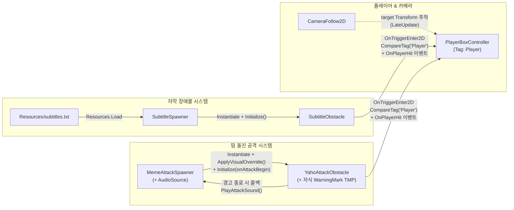
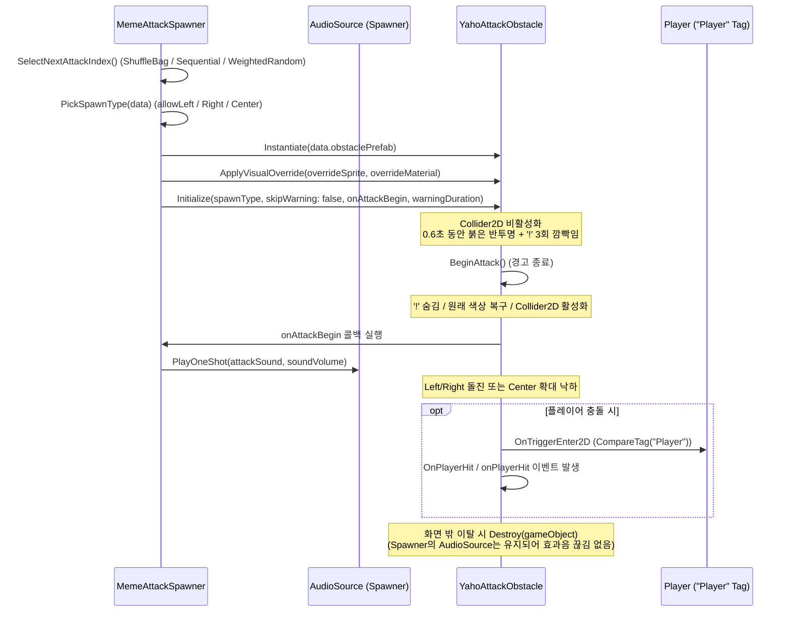

# 프로젝트 아키텍처 문서 (`Assets/Scripts`)

이 문서는 `Assets/Scripts` 폴더에 포함된 모든 런타임 스크립트의 **역할**, **핵심 변수 및 데이터 구조**, **스크립트 간 호출·충돌·이벤트 관계**를 정리한 문서입니다.

---

## 1. 전체 구조 개요

현재 런타임 스크립트는 총 6개이며, 크게 3개의 독립적인 도메인으로 구성되어 있습니다.

| 도메인 | 스크립트 | 한 줄 요약 |
| --- | --- | --- |
| **플레이어 & 카메라** | `PlayerBoxController.cs` | 2D 좌우 이동 및 다단 점프 물리 제어 |
| | `CameraFollow2D.cs` | 타겟(플레이어)의 2D 위치를 추적하는 직교 카메라 |
| **자막 낙하 장애물** | `SubtitleSpawner.cs` | `Resources` 텍스트 파일 파싱 후 주기적으로 자막 장애물 생성 |
| | `SubtitleObstacle.cs` | 태그별 스타일·낙하 패턴 적용, 텍스트 크기 기반 히트박스 자동 맞춤 및 피격 판정 |
| **밈 돌진 공격** | `MemeAttackSpawner.cs` | 셔플백/순차/가중치 랜덤 모드로 밈 장애물 스폰 및 돌진 효과음 재생 |
| | `YahoAttackObstacle.cs` | 0.6초 경고 깜빡임(붉은 틴트 + `'!'`) 후 좌/우 돌진 또는 중앙 확대 낙하 및 피격 판정 |

---

## 2. 스크립트별 상세 명세

### 2.1 `PlayerBoxController.cs`
- **역할**: 플레이어의 2D 횡이동(`A`/`D`)과 다단 점프(`W`/`Space`)를 `Rigidbody2D` 기반으로 처리합니다. New Input System(`ENABLE_INPUT_SYSTEM`)과 구 Input Manager를 모두 조건부 컴파일로 지원합니다.
- **필수 컴포넌트**: `Rigidbody2D`, `BoxCollider2D`
- **핵심 변수**
  - `moveSpeed` (`float`, 기본 `6f`): 수평 이동 속도
  - `jumpForce` (`float`, 기본 `12f`): 점프 시 수직 속도
  - `maxJumps` (`int`, 기본 `2`): 최대 연속 점프 횟수(더블 점프)
  - `gravityScale` (`float`, 기본 `3f`): 중력 배율
  - `groundCheckDistance` (`float`, 기본 `0.1f`): 바닥 판정용 `BoxCastAll` 거리
  - 내부 상태: `moveInputX`, `jumpRequested`, `jumpsRemaining`
- **주요 동작**
  - `Update()`: 입력 수집(`moveInputX`, `jumpRequested`).
  - `FixedUpdate()`: `CheckGrounded()`로 착지 여부를 판정해 `jumpsRemaining`을 갱신하고 `rb.linearVelocity`를 업데이트.
  - `CheckGrounded()`: 트리거가 아닌 바닥 콜라이더 중 법선 `normal.y > 0.5f`인 충돌만 접지로 인정.

---

### 2.2 `CameraFollow2D.cs`
- **역할**: 2D 직교(`orthographic = true`) 카메라가 `target`의 X/Y 좌표를 `offset`을 더해 추적합니다.
- **필수 컴포넌트**: `Camera`
- **핵심 변수**
  - `target` (`Transform`): 추적 대상 (주로 플레이어)
  - `offset` (`Vector3`, 기본 `(0, 0, -10)`): 카메라 위치 오프셋
- **주요 동작**
  - `Awake()`: `cam.orthographic = true` 강제 설정.
  - `LateUpdate()`: `target` 이동이 끝난 뒤 카메라 위치를 `(target.x + offset.x, target.y + offset.y, offset.z)`로 갱신.

---

### 2.3 `SubtitleSpawner.cs`
- **역할**: `Assets/Resources`의 텍스트 파일에서 자막 목록을 로드·파싱하고, 일정 주기(`spawnInterval`)마다 랜덤 자막을 화면 상단에서 `SubtitleObstacle`로 생성합니다.
- **내부 타입**: `SubtitleEntry` (`Tag`, `SpeedScale`, `Text`)
- **핵심 변수**
  - `resourceFileName` (`string`, 기본 `"subtitles"`): 로드할 텍스트 리소스명 (실패 시 `"Subtitle"`, `"Subtitles"`, `"subtitle"` 폴백)
  - `obstaclePrefab` (`SubtitleObstacle`): 생성할 자막 프리팹 (비어 있으면 런타임에 `GameObject` 동적 생성)
  - `fontAsset` (`TMP_FontAsset`): 자막에 적용할 TMP 폰트
  - `spawnInterval` (`float`, 기본 `1.6f`), `spawnOnStart` (`bool`, 기본 `true`)
  - `baseFallSpeed` (`float`, 기본 `3.5f`), `speedRandomVariance` (`float`, 기본 `0.5f`)
  - 스폰 범위: `spawnY` (`6.5f`), `minSpawnX` (`-4.5f`), `maxSpawnX` (`4.5f`), `wallMaxAbsX` (`2.0f`, `Wall` 태그 전용 X 범위)
  - 내부 상태: `entries` (`List<SubtitleEntry>`), `spawnTimer`
- **지원 텍스트 포맷 (`ParseLine`)**
  - `유형|속도배율|자막내용` (예: `FAST|1.8|억까 멈춰!!`)
  - `유형|자막내용` (예: `ZIGZAG|흔들흔들`)
  - `자막내용` (기본 `Normal`, 배율 `1.0`)
  - `#`으로 시작하는 줄은 주석으로 무시
- **주요 메서드**: `LoadSubtitles()`, `SpawnRandomSubtitle()`

---

### 2.4 `SubtitleObstacle.cs`
- **역할**: `TextMeshPro` 기반 낙하 자막 장애물입니다. 태그(`SubtitleTag`)에 따라 색상·폰트 크기·속도를 설정하고, 렌더링된 텍스트 크기에 맞춰 `BoxCollider2D`를 자동 조절합니다.
- **필수 컴포넌트**: `TextMeshPro`, `BoxCollider2D`, `Rigidbody2D` (Kinematic, `gravityScale = 0`, `isTrigger = true`)
- **공개 타입 & 이벤트**
  - `enum SubtitleTag { Normal, Fast, Wall, Zigzag, Heavy }`
  - `public static event Action<SubtitleObstacle> OnPlayerHit;`
- **핵심 변수**
  - 컴포넌트: `textMesh`, `boxCollider`, `rb`
  - 크기/폰트: `colliderPadding`, `minColliderSize`, `baseFontSize`, `fastFontSize`, `wallFontSize`, `heavyFontSize`
  - 태그 색상: `normalTextColor`, `fastTextColor`, `wallTextColor`, `zigzagTextColor`, `heavyTextColor`
  - 이동: `fallSpeed`, `minFallSpeed`, `zigzagAmplitude` (`1.8f`), `zigzagFrequency` (`4.2f`), `destroyY` (`-7.5f`)
  - 기본 속도 배율 폴백: `fastSpeedScale` (`1.8f`), `wallSpeedScale` (`0.65f`), `heavySpeedScale` (`0.8f`)
  - 프로퍼티: `TagType`, `SubtitleText`, `FallSpeed`
- **주요 메서드**
  - `Initialize(...)`: 텍스트·태그·속도·폰트 적용 후 `UpdateSizeToFitText()` 호출.
  - `UpdateSizeToFitText()`: TMP 메쉬 강제 갱신 후 `BoxCollider2D.size` 및 `offset`을 텍스트 크기에 맞춤.
  - `Update()`: 수직 낙하 (`Zigzag` 태그는 `Mathf.Sin` 수평 흔들림 추가), `pos.y < destroyY` 시 `Destroy(gameObject)`.
  - `OnTriggerEnter2D()`: `"Player"` 태그 충돌 시 `OnPlayerHit` 이벤트 발생 후 자신 파괴.

---

### 2.5 `MemeAttackSpawner.cs`
- **역할**: 여러 밈 장애물(`MemeAttackData`)을 등록해 두고, 선택한 출력 모드(`ShuffleBag`, `Sequential`, `WeightedRandom`)에 따라 스폰하고 경고 종료 시점에 맞춰 효과음을 재생하는 범용 스포너입니다.
- **필수 컴포넌트**: `AudioSource` (2D 사운드 `spatialBlend = 0f`, `playOnAwake = false`)
- **공개 타입**
  - `enum MemeOrderMode { ShuffleBag, Sequential, WeightedRandom }`
  - `class MemeAttackData`:
    - `obstaclePrefab` (`YahoAttackObstacle`)
    - `overrideSprite` (`Sprite`), `overrideMaterial` (`Material`)
    - `attackSound` (`AudioClip`), `soundVolume` (`0~1`)
    - `spawnWeight` (`>= 0.01f`, `WeightedRandom`용 가중치)
    - `allowLeft`, `allowRight`, `allowCenter` (`bool`, 허용 스폰 방향)
- **핵심 변수**
  - `orderMode` (`MemeOrderMode`, 기본 `ShuffleBag`)
  - `memeAttacks` (`List<MemeAttackData>`)
  - `audioSource` (`AudioSource`)
  - 타이밍: `initialDelay` (`1.5f`), `warningDuration` (`0.6f`), `repeatSpawn` (`false`), `spawnInterval` (`4.5f`)
  - 스폰 위치: `leftSpawnX` (`-7.5f`), `rightSpawnX` (`7.5f`), `horizontalMinY` (`-2.6f`), `horizontalMaxY` (`1.6f`), `centerSpawnPosition` (`(0, 2.2)`), `centerRandomOffsetX` (`1.2f`)
  - 내부 상태: `shuffleBag`, `validIndicesBuffer`, `allowedSpawnTypesBuffer`, `sequentialCursor`, `lastSpawnedIndex`, `spawnRoutine`
- **출력 모드별 동작**
  - **`ShuffleBag` (기본값)**: 유효 인덱스를 Fisher-Yates 셔플해 순차 소비. 가방 리필 시 항목이 2개 이상이면 `shuffleBag[0] == lastSpawnedIndex`일 때 다른 위치와 스왑하여 **연속 중복 방지**.
  - **`Sequential`**: `sequentialCursor`를 순환 증가시키며 순서대로 출력.
  - **`WeightedRandom`**: `spawnWeight` 합계 기반 확률 추첨.
- **주요 메서드**: `SpawnNextAttack()`, `SpawnAttack(int index, YahoSpawnType? forcedSpawnType = null)`, `ResetOrderState()`, `PlayMemeAttackSequence(...)`, `PlayAttackSound(...)`

---

### 2.6 `YahoAttackObstacle.cs`
- **역할**: 밈 돌진 장애물 본체입니다. 스폰 직후 일정 시간(`0.6초`) 동안 콜라이더를 끈 채 붉은색 반투명 + 빨간 `'!'` 느낌표로 3회 경고 깜빡임을 수행한 뒤, 경고가 끝나는 순간 원래 색상·콜라이더를 복구하며 돌진(좌/우 수평 돌진 또는 중앙 하강 확대)합니다.
- **필수 컴포넌트**: `SpriteRenderer`, `BoxCollider2D`, `Rigidbody2D` (Kinematic, `gravityScale = 0`, `isTrigger = true`)
- **공개 타입 & 이벤트**
  - `enum YahoSpawnType { Left, Right, Center }`
  - `public static event Action<YahoAttackObstacle> OnAttackStart;`
  - `public static event Action<YahoAttackObstacle> OnPlayerHit;`
  - Inspector `UnityEvent`: `onAttackStart`, `onPlayerHit`
- **핵심 변수**
  - 컴포넌트: `spriteRenderer`, `obstacleCollider`, `warningText` (`TextMeshPro`, 없으면 런타임에 자식 `WarningMark` 자동 생성)
  - 경고 단계: `warningDuration` (`0.6f`), `warningBlinkCount` (`3`), `warningSpriteColor`, `warningMinAlpha` (`0.15f`), `warningMaxAlpha` (`0.65f`), `warningTextColor`, `warningTextMinAlpha` (`0.15f`), `warningTextMaxAlpha` (`1f`), `defaultWarningFontSize` (`26f`)
  - 수평 돌진(`Left`/`Right`): `horizontalDashSpeed` (`18f`), `horizontalScale` (`0.85f`), `offScreenLimitX` (`15f`)
  - 중앙 낙하(`Center`): `centerDownSpeed` (`9f`), `centerStartScale` (`0.35f`), `centerMaxScale` (`1.65f`), `centerScaleGrowSpeed` (`1.4f`), `offScreenMinY` (`-10f`)
  - 프로퍼티: `SpawnType`, `IsAttacking`, `WarningDuration`
- **주요 메서드**
  - `ApplyVisualOverride(Sprite, Material)`: 스포너의 `MemeAttackData`에 지정된 스프라이트/머티리얼을 덮어쓰고, 스프라이트 바운드(`0.75x`)에 맞춰 `BoxCollider2D` 크기·오프셋을 재계산.
  - `Initialize(YahoSpawnType, bool skipWarning, Action onAttackBegin, float warningDurationOverride)`: 방향/스케일/반전(`Right`일 때 `flipX = true`) 설정 및 경고 단계 진입(콜라이더 비활성화, `'!'` 표시).
  - `UpdateWarningPhase()`: `warningDuration` 동안 `warningBlinkCount`회 붉은 반투명 및 `'!'` 알파 깜빡임 처리.
  - `BeginAttack()`: `'!'` 숨김, 원래 `baseColor` 복구, `obstacleCollider.enabled = true`, `onAttackBeginCallback` 호출(스포너 효과음 재생), `OnAttackStart` / `onAttackStart` 발생.
  - `UpdateAttackPhase()`: `Left`(+X), `Right`(-X), `Center`(-Y 및 스케일 확대) 이동 후 화면 밖 이탈 시 `Destroy(gameObject)`.
  - `OnTriggerEnter2D()`: 공격 중(`isAttacking && !hasHitPlayer`) `"Player"` 태그 충돌 시 `OnPlayerHit` / `onPlayerHit` 발생.

---

## 3. 스크립트 간 호출 관계 및 실행 시퀀스

### 3.1 직접 메서드 호출 및 콜백 흐름

| 호출 주체 | 대상 스크립트 | 호출 메서드 / 접점 | 목적 |
| --- | --- | --- | --- |
| `CameraFollow2D` | `PlayerBoxController` (Transform) | `target.position` 참조 | 매 프레임(`LateUpdate`) 플레이어 위치 추적 |
| `SubtitleSpawner` | `SubtitleObstacle` | `Instantiate` → `Initialize(...)` | 파싱된 자막 텍스트·태그·속도·폰트 전달 |
| `MemeAttackSpawner` | `YahoAttackObstacle` | `Instantiate` → `ApplyVisualOverride(...)` | `MemeAttackData`의 스프라이트·머티리얼·히트박스 적용 |
| `MemeAttackSpawner` | `YahoAttackObstacle` | `Initialize(..., onAttackBegin: () => PlayAttackSound(...))` | 경고 깜빡임 시작 및 돌진 시점 효과음 콜백 등록 |
| `MemeAttackSpawner` | `YahoAttackObstacle` | `instance.IsAttacking` 폴링 (`while` 코루틴) | 경고 종료 후 다음 스폰 간격(`spawnInterval`) 대기 시작 |
| `YahoAttackObstacle` | `MemeAttackSpawner` | `onAttackBeginCallback?.Invoke()` | 경고 종료와 동시에 스포너 `AudioSource.PlayOneShot` 실행 |

### 3.2 밈 돌진 공격 시퀀스 다이어그램

### 3.3 정적 이벤트 및 충돌 접점 요약

- **충돌 태그 계약**: `SubtitleObstacle`과 `YahoAttackObstacle` 모두 `OnTriggerEnter2D`에서 `other.CompareTag("Player")`를 검사하므로, 플레이어 오브젝트에는 반드시 **`Player` 태그**가 부여되어 있어야 합니다.
- **외부 구독용 이벤트** (추후 `GameManager` / UI / 점수 시스템 연동 지점):
  - `SubtitleObstacle.OnPlayerHit` (`Action<SubtitleObstacle>`)
  - `YahoAttackObstacle.OnPlayerHit` (`Action<YahoAttackObstacle>`) + Inspector `UnityEvent onPlayerHit`
  - `YahoAttackObstacle.OnAttackStart` (`Action<YahoAttackObstacle>`) + Inspector `UnityEvent onAttackStart`
- **결합도 특징**: 현재 `PlayerBoxController`, `SubtitleSpawner`, `MemeAttackSpawner`는 서로를 직접 참조하지 않고 독립적으로 동작하며, 장애물과 플레이어 간 상호작용만 2D Trigger 충돌과 정적 이벤트로 느슨하게 연결되어 있습니다.
